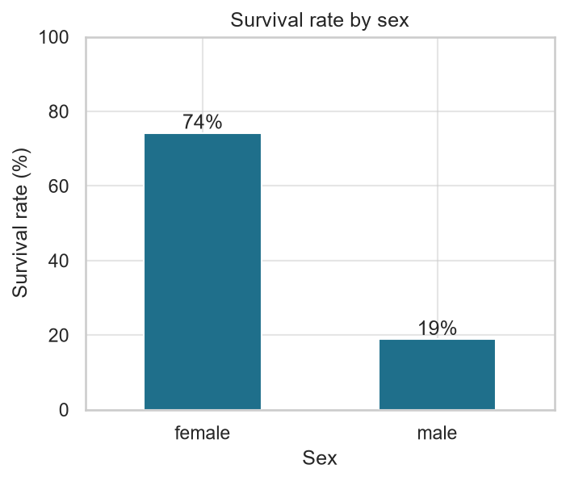
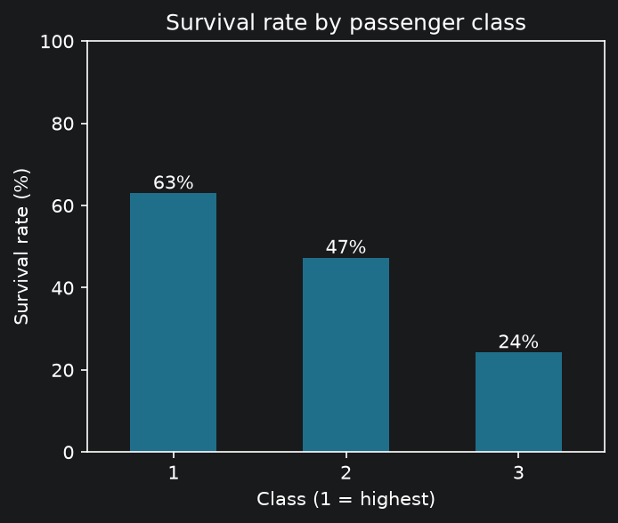
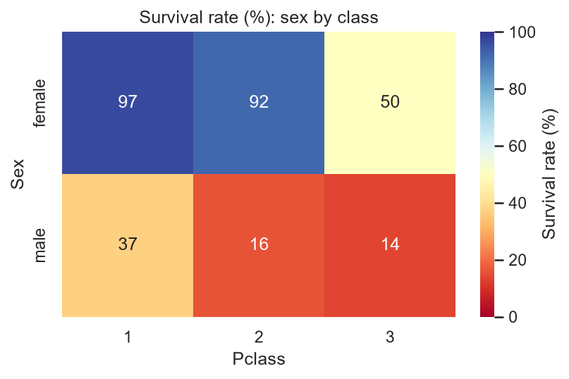
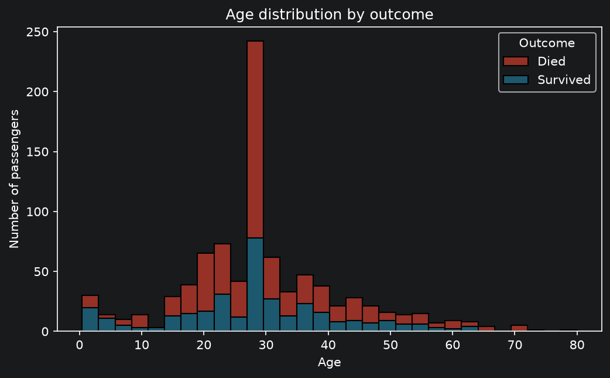
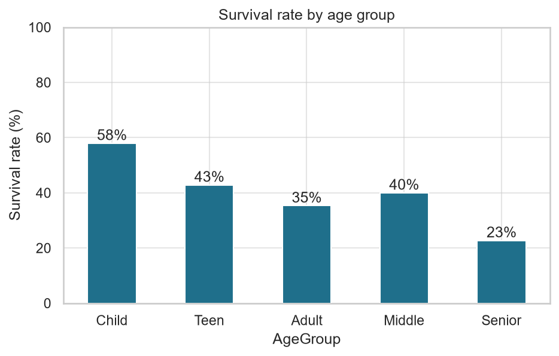
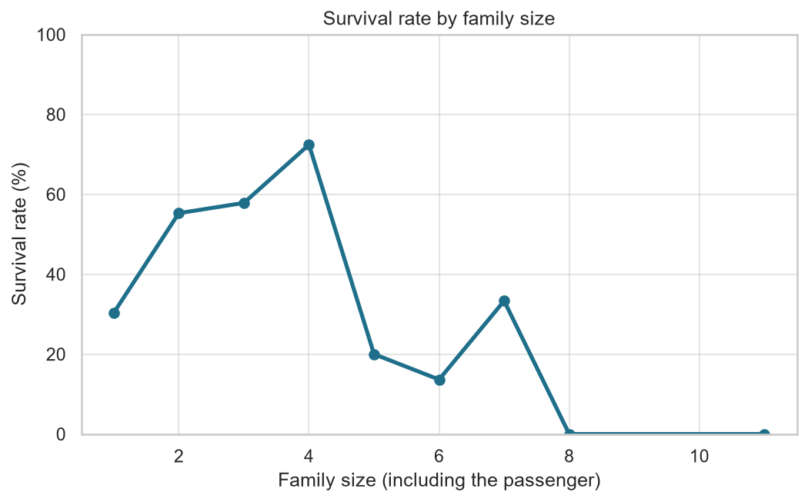

# Titanic Survival Analysis

Which factors were linked to survival on the Titanic? An exploratory analysis of 891 passengers in Python
(pandas, matplotlib, seaborn).

**Open `titanic-analysis.ipynb` for the full walkthrough.**

## Key findings
- Overall survival was **38.4%**.
- **Sex:** women survived at 74.2%, men at 18.9%.
- **Class:** 63.0% (1st), 47.3% (2nd), 24.2% (3rd).
- **Together:** 1st-class women survived at about 97%, 3rd-class men at about 14%.
- **Children (0-12)** had the highest age-group survival, about 58%.
- **Family size:** people travelling alone survived at about 30%, families of 2-4 did better (up to about 72% for 4).

## Charts

### Survival by sex


### Survival by passenger class


### Sex and class together


### Age distribution by outcome
The spike at age 28 is not a real pattern. It comes from the 177 missing ages filled with the median.



### Survival by age group


### Survival by family size
Sizes 8 and 11 have only 6 and 7 passengers, so their 0% reflects very little data.



## Data cleaning

| Column | Missing | Treatment |
|---|---|---|
| Age | 177 (19.9%) | Filled with the median age |
| Embarked | 2 (0.2%) | Filled with the most common port (Southampton) |
| Cabin | 687 (77.1%) | Not filled; replaced by a `HasCabin` flag |

New columns: `FamilySize`, `IsAlone`, `Outcome`, `AgeGroup`, `Title` (rare titles grouped as "Rare").
The cleaned data is saved as `titanic_clean.csv` (891 rows, 18 columns).

## Tools
Python, pandas, matplotlib, seaborn, Jupyter Notebook, Git and GitHub.

## Run it yourself
```bash
git clone https://github.com/YohanaHiruy/Titanic-analysis.git
cd Titanic-analysis
pip install pandas matplotlib seaborn notebook
jupyter notebook
```
Open `titanic-analysis.ipynb` and run all cells. Keep `Titanic-Dataset.csv` in the same folder as the notebook.

## Files
- `titanic-analysis.ipynb`: cleaning, analysis and charts
- `Titanic-Dataset.csv`: raw data
- `titanic_clean.csv`: cleaned data
- `images/`: saved charts

## Limitations
- These are associations in the data, not proof of cause.
- 177 ages (20%) were filled with one median value, which creates the artificial spike at age 28.
- Cabin was too incomplete to analyse.
- The Child group is small (around 70 passengers), so its exact figure should be read with caution.
- The data covers 891 passengers, not everyone aboard.
